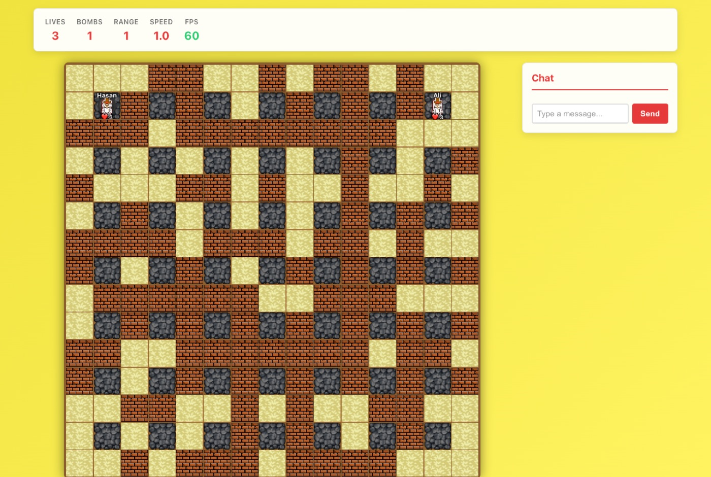
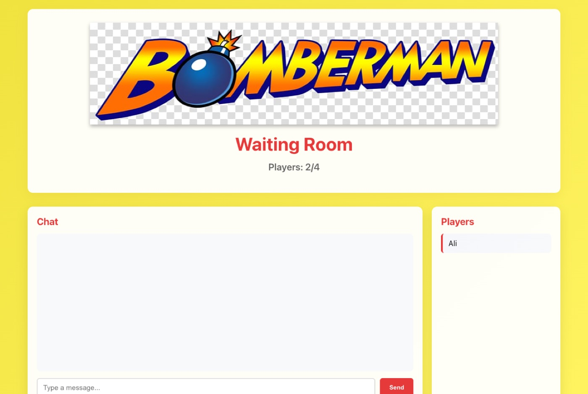

<div align="center">



# Bomberman DOM 💣

**Two to four players, one grid, three lives each. Multiplayer Bomberman on a framework I wrote myself.**

    

</div>

<p align="center"></p>

## Features

- **Multiplayer Support**: 2-4 players can join and play together
- **Real-time Communication**: WebSocket-based chat and game synchronization
- **Game Mechanics**:
  - 3 lives per player
  - Bomb placement and explosions
  - Power-ups (Bombs, Flames, Speed)
  - Destroyable blocks and permanent walls
  - 15x15 grid map
- **Performance Optimized**: 
  - 60 FPS target using `requestAnimationFrame`
  - CSS transforms for smooth animations
  - Minimal layer promotion

## Requirements

- Node.js (v14 or higher)
- npm or yarn

## Installation

1. Install dependencies:
```bash
npm install
```

## Running the Game

1. Start the server:
```bash
npm start
```

2. Open your browser and navigate to:
```
http://localhost:3000
```

3. The WebSocket server will run on port 3001 automatically.

## How to Play

1. **Enter Nickname**: When you first open the game, enter your nickname
2. **Waiting Room**: You'll be taken to a waiting room where you can:
   - See other players joining (up to 4 players)
   - Chat with other players
   - Wait for the game to start
3. **Game Start**: 
   - If 4 players join, a 10-second countdown starts immediately
   - If 2-3 players join, wait 20 seconds, then a 10-second countdown starts
4. **Gameplay**:
   - **Movement**: Use WASD or Arrow Keys
   - **Place Bomb**: Press Spacebar
   - **Objective**: Be the last player standing!

## Game Rules

- Each player starts with 3 lives
- Players start in the corners of the map
- Bombs explode after 3 seconds
- Destroying blocks may spawn power-ups:
  - **Bombs**: Increase max bombs you can place
  - **Flames**: Increase explosion range
  - **Speed**: Increase movement speed
- When you lose all 3 lives, you're eliminated

## Project Structure

```
bomberman-dom/
├── server.js              # WebSocket server
├── index.html             # Main HTML file
├── styles.css             # Game styles
├── package.json           # Dependencies
├── src/
│   ├── app.js            # Main application
│   ├── websocket.js      # WebSocket client
│   ├── framework/        # Mini-framework
│   │   ├── dom.js
│   │   ├── store.js
│   │   ├── router.js
│   │   ├── events.js
│   │   └── index.js
│   ├── pages/            # Page components
│   │   ├── nickname-page.js
│   │   ├── waiting-room.js
│   │   └── game-page.js
│   └── game/             # Game logic
│       └── game-engine.js
└── objectives/           # Project requirements
```

## Technical Details

- **Framework**: Custom mini-framework (no external frameworks)
- **Rendering**: DOM manipulation with virtual DOM abstraction
- **Performance**: Optimized for 60 FPS using `requestAnimationFrame`
- **Communication**: WebSocket for real-time multiplayer sync
- **State Management**: Centralized store with action-based updates

## Development

The game is built following performance best practices:
- Uses CSS `transform` instead of `left/top` for animations
- Minimal layer promotion with `will-change`
- Efficient DOM updates
- Frame rate monitoring

## Notes

- Make sure the server is running before opening the game in the browser
- The game requires at least 2 players to start
- Maximum 4 players can join a game


Built at **[Reboot01](https://reboot01.com)**, Bahrain.

---

<div align="center">

Built by **Hasan Abdulla** · [github.com/hx03s](https://github.com/hx03s) · Bahrain 🇧🇭

</div>
